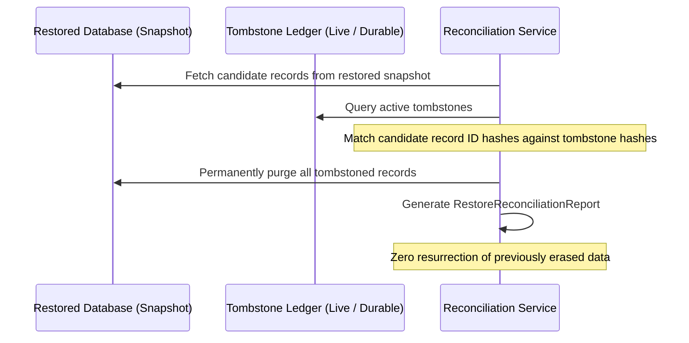

# Orbit Chat — Backup, Restore & Disaster Recovery (Spec 41)

## 1. RPO & RTO Commitments

| Metric | Target | Verification Method |
|---|---|---|
| **Recovery Point Objective (RPO)** | **< 5 minutes** | Continuous WAL archiving + automated point-in-time recovery (PITR) testing |
| **Recovery Time Objective (RTO)** | **< 30 minutes** | Automated multi-region database failover and container orchestration rollback |

---

## 2. Deletion Tombstone Ledger & Anti-Resurrection Principle

When a user exercises their GDPR Right to Erasure or deletes a message/conversation:
1. Primary records are erased immediately from live storage.
2. An entry is recorded in the cryptographically hashed `DeletionTombstoneLedger`.
3. The tombstone contains:
   - `targetType`: Target object category (`message`, `attachment`, `user`)
   - `targetIdHash`: SHA-256 hash of the identifier (ensuring deleted IDs are never stored in plaintext)
   - `tombstoneHash`: Verification digest ensuring the tombstone cannot be tampered with.

### Restore Reconciliation Procedure:

---

## 3. Disaster Recovery Drill Schedule
- **Monthly**: Automated database snapshot restore and integrity verification in isolated staging environment.
- **Quarterly**: Game day drill testing regional failover and tombstone ledger reconciliation.
- **Bi-annual**: Full platform cold-start restoration from immutable backup storage.

---

## 4. Automated Verification

The anti-resurrection path is covered by automated tests, not only by procedure:

- `apps/api/src/backup.test.ts` — backup export/restore round-trip, idempotent
  restore (`ON CONFLICT DO NOTHING`), checksum/row-count checks.
- `packages/domain/src/security-expansion.test.ts` — deletion tombstone ledger
  and `reconcileRestore` purge restored records whose hashed ids are tombstoned.
- `packages/domain/src/retention.test.ts` — deletion/expiry invariants.

CI runs these on every change. A restore is **not** complete until:

1. Restored database integrity and migration version are verified.
2. `reconcileRestore` has run and produced a report of purged candidates.
3. Revoked sessions, suspended workspaces and legal holds are re-applied.
4. Media restore reconciles tombstones for attachment blobs before serving.
5. A smoke test confirms login, send, read and export authorization.

## 5. Backup Security & Retention

- Backups are encrypted at rest and in transit; encryption keys are managed
  separately from the backup storage account and rotated on schedule.
- Object storage immutability/versioning protects against ransomware and
  accidental deletion. Production credentials cannot delete all backups.
- Access is least-privilege, MFA-protected and audited. Restores into staging use
  synthetic or approved data and are destroyed after verification.
- Backup expiry is documented and enforced; retaining expired data beyond the
  schedule is a privacy violation. Restores reapply tombstones before exposure.
- Record each drill: date, snapshot id, restore duration, reconciliation counts,
  smoke results, issues and owners. Keep evidence with the release package.
