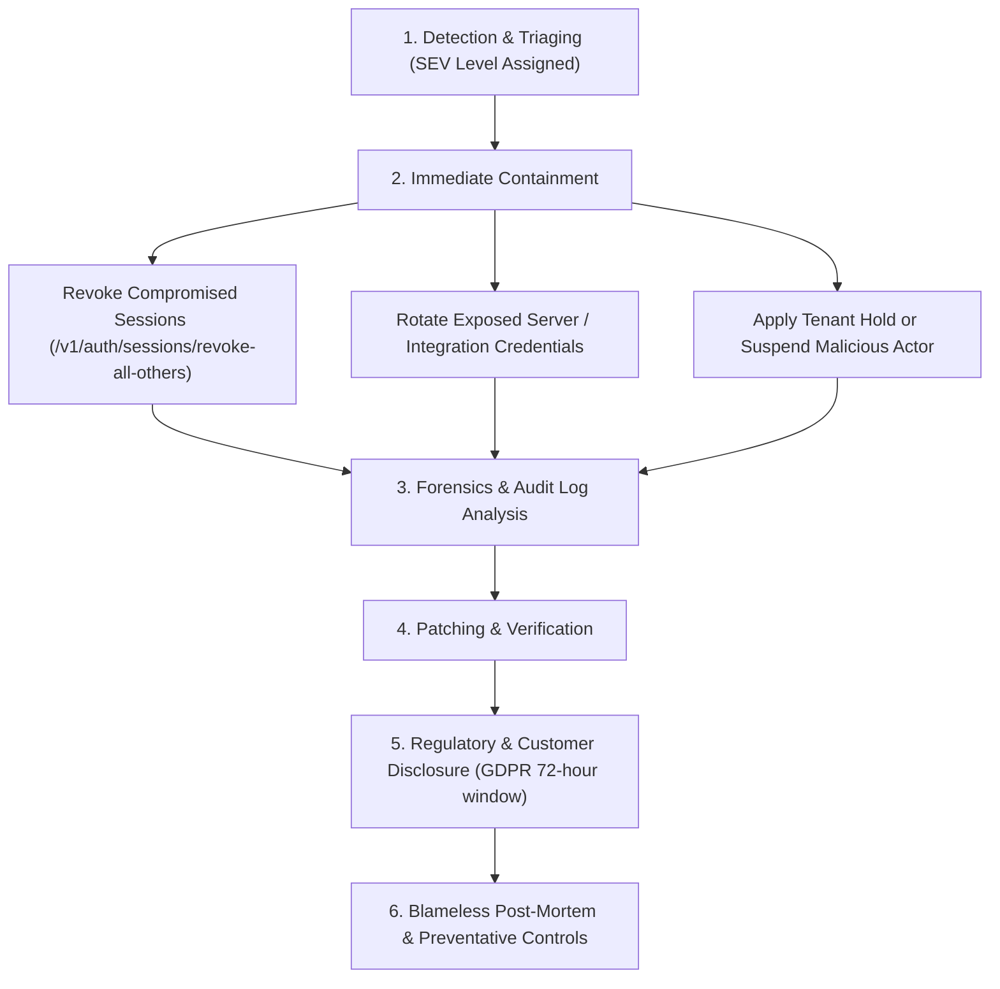

# Orbit Chat — Incident Response & Breach Playbook (Spec 40)

## 1. Incident Severity Classification

| Severity Level | Definition | Response SLA | Leadership Notification |
|---|---|---|---|
| **SEV-1 (Critical)** | Active data exfiltration, total platform outage, private key compromise, or cross-tenant data leakage. | Immediate (< 15 mins) | CEO, CTO, Head of Legal, CISO |
| **SEV-2 (Major)** | Core service impairment (e.g., messaging delayed > 5 mins, partial auth outage), isolated unauthorized API access. | < 1 hour | CTO, Head of Security, Engineering Lead |
| **SEV-3 (Moderate)** | Non-critical bug, degraded performance in single region, edge-case rate limit trigger. | < 4 hours | Incident Commander, On-Call Engineer |
| **SEV-4 (Minor)** | Minor UI inconsistency, non-exploitable error logging anomaly. | Next business day | Assigned Squad Lead |

---

## 2. Standard Containment Workflows

### Immediate Containment Actions:
1. **Compromised User Device**: Call `/v1/auth/sessions/:id/revoke` or `/v1/auth/sessions/revoke-all-others` to invalidate all refresh tokens and terminate realtime WebSocket channels.
2. **Compromised Integration / Bot**: Call `/v1/integrations/:id/revoke` to instantly invalidate bot API tokens and block inbound webhooks.
3. **Malicious Workspace Abuse**: Update workspace status to `suspended` in `store.workspaces`; all routes immediately return `403 FORBIDDEN`.

---

## 3. Regulatory & Customer Communications (GDPR / Privacy Mandate)
- In the event of confirmed personal data breach, notification to relevant supervisory authorities must occur within **72 hours** of becoming aware.
- Disclosures must state:
  1. Nature of the personal data involved (e.g. metadata only vs message ciphertext).
  2. Measures taken or proposed to address and mitigate adverse effects.
  3. Recommended actions for affected users (e.g. verify safety numbers, revoke linked devices).

---

## 4. Exercised Scenarios & Drill Cadence

Tabletop exercises and technical drills keep this playbook usable under pressure.
Legal/communications review is included; findings are tracked to closure.

| Cadence | Scenario | Success criteria | Evidence |
|---|---|---|---|
| Quarterly | Stolen session/refresh token and lost admin device | Revocation + step-up + audit trail within SLA | Drill record, timeline |
| Quarterly | Cross-tenant access report (IDOR/BOLA) | Tenant isolation confirmed, affected scope identified, disclosure decision | Reproduction test, post-mortem |
| Semi-annual | Database restore with deletion tombstones | Restored data serves traffic only after `reconcileRestore`; zero resurrection | `backup.test.ts`, `security-expansion.test.ts`, restore log |
| Semi-annual | Compromised third-party integration/webhook secret | Key revoked/rotated, replay blocked, no secret in logs | Rotation record, scanner output |
| Annual | Ransomware/region loss | RTO/RPO met from immutable backups | Game-day report |

Every drill records: date, facilitator, participants, scenario, detection time,
containment time, decisions, customer/regulator impact, and action items with
owners and due dates. Unresolved actions block the next release gate if they
touch auth, tenancy, deletion or backups.

## 5. Communications & Evidence

- Pre-approved templates (initial acknowledgement, update, resolution) live with
  Legal; engineering supplies facts, Legal approves regulatory wording.
- Preserve logs, audit records, snapshots and scanner output before remediation
  destroys evidence. Access to evidence is restricted and logged.
- Notify the security owner and DPO immediately for any confirmed or suspected
  personal-data breach; the 72-hour clock starts at awareness, not confirmation.
- Post-incident review (blameless) within 5 business days for SEV-1/SEV-2;
  preventative controls are added to the risk register with owners and dates.

## 6. Metrics

Track time-to-detect, time-to-contain, time-to-notify, percentage of drills with
met criteria, and repeat root causes. Review monthly with engineering and
security; trends feed the SLO/error-budget review in
`docs/operations/slo-reliability-cost.md`.
